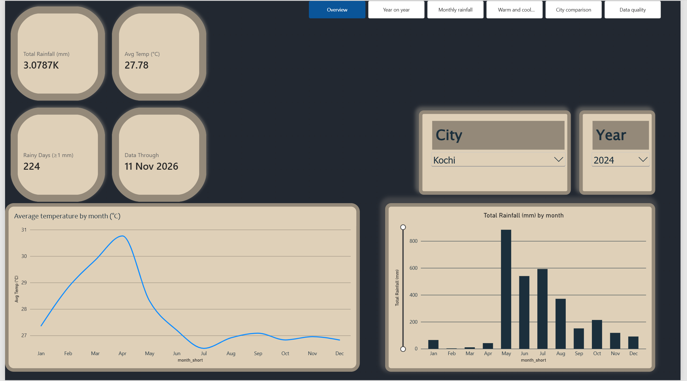
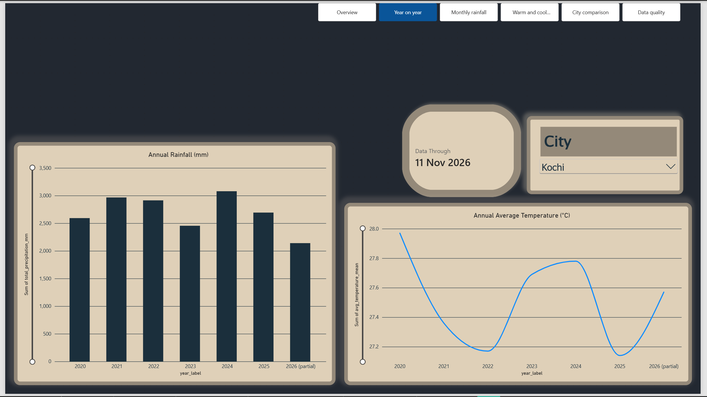
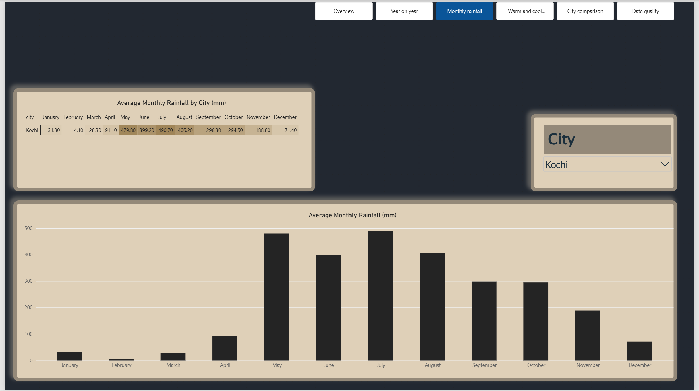
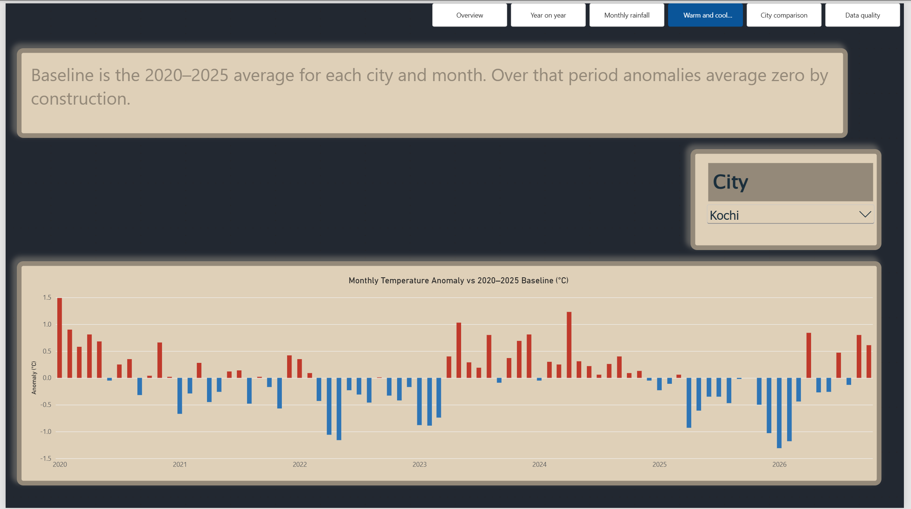
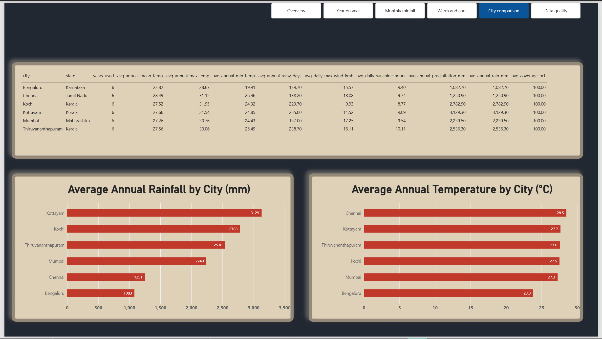
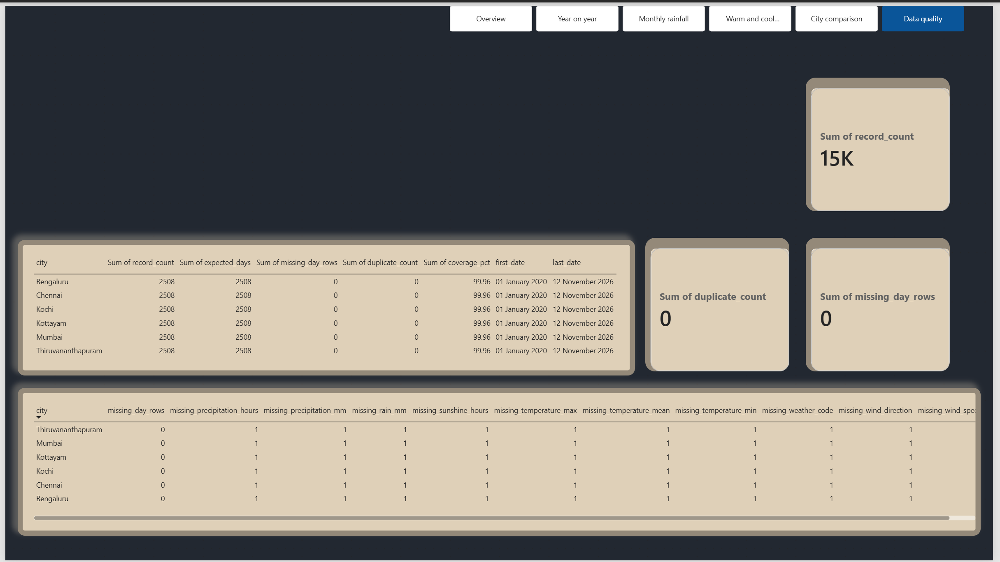

# STORMTRACE
### Historical Weather Data Engineering Pipeline — India

STORMTRACE is an end-to-end weather data engineering and analytics project that collects historical ERA5 weather data for six Indian cities, processes and validates the data using Python, stores it in PostgreSQL, and makes it available for analytical reporting in Power BI.

The project focuses on building a reproducible data pipeline and exploring historical temperature trends, rainfall seasonality, monthly temperature anomalies, and weather differences across cities.

---

## Project Overview

| Property | Description |
|---|---|
| Project | STORMTRACE |
| Domain | Data Engineering / Weather Analytics |
| Data source | Open-Meteo Historical Weather API |
| Weather model | ERA5 |
| Historical start | 2020-01-01 |
| Planned end | 2026-12-31 |
| Geography | India |
| Locations | 6 cities |
| Timezone | Asia/Kolkata |
| Storage | PostgreSQL |
| Reporting | Power BI |

The extraction end date is calculated dynamically using the current date in India minus five days, to account for ERA5's publication delay. Consequently, 2026 is a partial year until the full calendar year becomes available.

The theoretical full-period target for 2020–2026 is 15,342 daily city records (2,557 calendar days × 6 cities). This is a target, not a claim about the number of records currently loaded.

## Cities Covered

| City | State |
|---|---|
| Kochi | Kerala |
| Kottayam | Kerala |
| Thiruvananthapuram | Kerala |
| Bengaluru | Karnataka |
| Mumbai | Maharashtra |
| Chennai | Tamil Nadu |

The project uses configured city-centre coordinates as API request locations. These are not individual weather-station coordinates.

## Architecture

```text
             Open-Meteo Historical API
                       |
                  ERA5 Data
                       |
                       v
                Python Extraction
                       |
                       v
                  Raw JSON
                  data/raw/
                       |
                       v
              Pandas Transformation
                       |
                       v
              Data Cleaning & QA
                       |
                       v
                Processed CSV
             data/processed/
                       |
                       v
                  PostgreSQL
              -----------------
                 dim_city
             fact_daily_weather
              -----------------
                       |
                       v
                Analytical SQL
                Five Views
                       |
                       v
                  Power BI
              Six-Page Dashboard
```

## Technology Stack

| Layer | Technology |
|---|---|
| Programming | Python 3.14+ |
| Environment management | uv |
| API extraction | Requests |
| Data transformation | Pandas |
| Database | PostgreSQL |
| Database driver | Psycopg 3 |
| Data quality | Python and Pytest |
| Analytics | PostgreSQL SQL |
| Visualization | Microsoft Power BI |
| Version control | Git and GitHub |
| Development environment | WSL2 Ubuntu and Antigravity |

## Weather Data

STORMTRACE requests ten daily weather variables from ERA5.

| Source variable | Standardized column | Unit |
|---|---|---|
| temperature_2m_max | temperature_max | °C |
| temperature_2m_min | temperature_min | °C |
| temperature_2m_mean | temperature_mean | °C |
| precipitation_sum | precipitation_mm | mm |
| rain_sum | rain_mm | mm |
| precipitation_hours | precipitation_hours | hours |
| weather_code | weather_code | WMO code |
| wind_speed_10m_max | wind_speed_max | km/h |
| wind_direction_10m_dominant | wind_direction | degrees |
| sunshine_duration | sunshine_hours | hours |

Sunshine duration is converted from seconds into hours during transformation.

### Data source and interpretation

Data is retrieved from the [Open-Meteo Historical Weather API](https://open-meteo.com/en/docs/historical-weather-api), using the ERA5 reanalysis model.

ERA5 is a reanalysis dataset, not a set of direct measurements from weather stations located at each requested city coordinate. It combines observations with numerical weather modelling to provide a consistent historical record.

ERA5 has an approximate spatial resolution of 0.25° (about 25 km) and is updated with an approximately five-day delay. These characteristics should be considered when interpreting city-level results.

Source attribution: Open-Meteo Historical Weather API. Data licence: [Creative Commons Attribution 4.0 International (CC BY 4.0)](https://creativecommons.org/licenses/by/4.0/).

## Pipeline Features

### 1. Extraction

- Requests daily ERA5 data from the Open-Meteo Archive API.
- Uses an explicit ERA5 model selection.
- Uses Asia/Kolkata as the daily timezone.
- Supports one-city or six-city extraction.
- Includes connection and timeout retry handling.
- Handles rate limiting and server errors.
- Saves individual raw JSON responses with extraction metadata and unique run identifiers.

### 2. Transformation

- Reads raw JSON responses.
- Standardizes API variable names.
- Converts dates and numeric values.
- Converts sunshine duration from seconds to hours.
- Adds city metadata.
- Combines data across extraction runs.
- Removes duplicate city/date records, retaining the latest extraction.
- Preserves missing measurements as missing rather than replacing them with zero.

### 3. Data Quality

The validation layer checks:

- Required columns and non-empty datasets.
- Valid dates and expected city identifiers.
- Duplicate city/date records.
- Minimum, mean and maximum temperature ordering.
- Negative precipitation, rain, precipitation hours and sunshine values.
- Wind direction range.
- Date range and gaps.
- Missing values and missingness percentages.

A quality report can be generated separately.

### 4. PostgreSQL Loading

The warehouse uses two main tables:

**dim_city** — city metadata and configured coordinates.

**fact_daily_weather** — one daily weather record per city and date.

The fact table uses a composite primary key on `(city_id, date)`. Data is loaded using an upsert strategy, allowing repeated loads to update existing records instead of creating duplicate city/date rows.

Missing Pandas values are converted to SQL NULL values before insertion.

### 5. Incremental Processing

The pipeline supports two modes:

- `backfill`: retrieves the historical range from the configured project start date.
- `incremental`: checks the latest stored date per city and re-requests a 60-day overlap to refresh recent preliminary ERA5 values.

The database upsert key makes repeated processing safe for existing city/date records.

---

## Analytical SQL Layer

The SQL layer creates five analytical views.

| SQL file | View | Purpose |
|---|---|---|
| 02_annual_weather_summary.sql | vw_annual_weather_summary | Annual weather trends and coverage |
| 03_rainfall_seasonality.sql | vw_monthly_rainfall_climatology | Monthly rainfall seasonality |
| 04_temperature_anomalies.sql | vw_monthly_temperature_anomalies | Monthly temperature anomalies |
| 05_city_comparison.sql | vw_long_term_city_comparison | Historical city comparison |
| 06_data_quality_summary.sql | vw_data_quality_summary | Database completeness and missingness |

### Annual weather trends

Summarizes annual average temperature, precipitation, rain, wind, sunshine, rainy days and observed-day coverage. Partial years are labelled.

### Rainfall seasonality

Uses complete monthly rainfall totals from the 2020–2025 baseline period. It calculates annual monthly totals first and then averages the available complete monthly totals. The view also reports how many baseline years were used and whether all six are represented.

### Temperature anomalies

Compares a city's complete monthly mean temperature against its 2020–2025 baseline for the same calendar month.

```text
Temperature anomaly =
Year's monthly mean temperature
-
2020–2025 baseline monthly mean temperature
```

Positive values indicate warmer months relative to the baseline; negative values indicate cooler months relative to the baseline.

The baseline requires all six years for the relevant city and calendar month.

This six-year project baseline is not a standard 30-year climate normal. Anomalies are descriptive comparisons and do not establish climate-change causation.

### Long-term city comparison

Compares city-level weather statistics over the 2020–2025 date window. The view includes `years_used`, which should be checked when interpreting a city's comparison results.

### Data quality summary

Provides record counts, date coverage, missing-day estimates, missing measurement counts, duplicate counts and last-loaded timestamps.

---

## Power BI Dashboard

The Power BI report is stored at:

`dashboard/STORMTRACE_Dashboard.pbix`

The report contains six analytical pages.

### 1. Overview



### 2. Year-on-Year Trends



### 3. Monthly Rainfall Seasonality



### 4. Temperature Anomalies



### 5. City Comparison



### 6. Data Quality



DAX calculations, calendar table logic and model relationship notes are documented in [`docs/dax_measures.md`](docs/dax_measures.md).

---

## Project Structure

```text
stormtrace/
│
├── config/
│   └── cities.json
│
├── dashboard/
│   └── STORMTRACE_Dashboard.pbix
│
├── data/
│   ├── raw/
│   └── processed/
│
├── docs/
│   ├── images/
│   ├── ARCHITECTURE.md
│   ├── DATA_DICTIONARY.md
│   ├── DEVELOPMENT_LOG.md
│   └── dax_measures.md
│
├── logs/
│
├── scripts/
│   ├── extract_weather.py
│   ├── transform_weather.py
│   ├── load_weather.py
│   ├── quality_report.py
│   └── run_pipeline.py
│
├── sql/
│   ├── 01_create_schema.sql
│   ├── 02_annual_weather_summary.sql
│   ├── 03_rainfall_seasonality.sql
│   ├── 04_temperature_anomalies.sql
│   ├── 05_city_comparison.sql
│   └── 06_data_quality_summary.sql
│
├── stormtrace/
│   ├── config.py
│   ├── pipeline.py
│   ├── logging_setup.py
│   ├── extract/
│   ├── transform/
│   ├── load/
│   └── validation/
│
├── tests/
│   ├── test_api_client.py
│   ├── test_clean.py
│   ├── test_load_data.py
│   ├── test_pipeline.py
│   ├── test_quality_checks.py
│   └── test_transform.py
│
├── .env.example
├── .gitignore
├── CHANGELOG.md
├── PROJECT_STATUS.md
├── pyproject.toml
└── requirements.txt
```

Raw and processed datasets, local environment secrets, virtual environments and runtime logs are intentionally excluded from Git.

---

## Setup and Execution

### Prerequisites

- Ubuntu running under WSL2
- Python 3.14 or newer
- uv
- PostgreSQL
- Git
- Power BI Desktop on Windows

### 1. Clone the repository

```bash
git clone https://github.com/brettleevector-art/stormtrace.git
cd stormtrace
```

### 2. Create the Python environment

```bash
uv venv --python 3.14 .venv
source .venv/bin/activate
uv pip install -r requirements.txt
```

### 3. Configure environment variables

```bash
cp .env.example .env
```

Update `.env` with your local PostgreSQL credentials.

```dotenv
DB_HOST=localhost
DB_PORT=5432
DB_NAME=stormtrace_dw
DB_USER=stormtrace_user
DB_PASSWORD=your_local_password
DB_SSLMODE=prefer

LOG_LEVEL=INFO
```

Never commit `.env` or expose its password.

### 4. Create the PostgreSQL database

Create a PostgreSQL role and database if they do not already exist:

```sql
CREATE ROLE stormtrace_user WITH LOGIN PASSWORD 'your_local_password';
CREATE DATABASE stormtrace_dw OWNER stormtrace_user;
```

Run the schema file:

```bash
psql -h localhost -U stormtrace_user -d stormtrace_dw \
  -v ON_ERROR_STOP=1 -f sql/01_create_schema.sql
```

### 5. Run a historical backfill

```bash
python scripts/run_pipeline.py --mode backfill
```

The pipeline extracts the available historical range from 2020-01-01 through its dynamically calculated safe end date, transforms and validates the data, writes the processed CSV and loads PostgreSQL.

### 6. Run incremental processing

```bash
python scripts/run_pipeline.py
```

Incremental mode is the default. It reprocesses the recent overlap and upserts the results.

### 7. Run individual stages

Extract all six cities:

```bash
python scripts/extract_weather.py
```

Extract only one city:

```bash
python scripts/extract_weather.py --city Kochi
```

Transform raw JSON files:

```bash
python scripts/transform_weather.py
```

Generate the data quality report:

```bash
python scripts/quality_report.py
```

Load the processed CSV into PostgreSQL:

```bash
python scripts/load_weather.py
```

### 8. Create the analytical views

After the schema and daily data have been loaded, execute:

```bash
for file in sql/02_*.sql sql/03_*.sql sql/04_*.sql sql/05_*.sql sql/06_*.sql
do
  psql -h localhost -U stormtrace_user -d stormtrace_dw \
    -v ON_ERROR_STOP=1 -f "$file" || exit 1
done
```

### 9. Run tests

```bash
pytest -v
```

### 10. Connect Power BI

Open `dashboard/STORMTRACE_Dashboard.pbix` in Power BI Desktop and connect to the PostgreSQL database using:

- Server: `localhost:5432`
- Database: `stormtrace_dw`
- User: `stormtrace_user`
- Password: the local password from `.env`

Refresh the report after the database has been populated and the analytical views have been created.

---

## Data Interpretation and Limitations

- ERA5 is gridded reanalysis data, not direct city weather-station observations.
- Requested coordinates represent locations used to select model grid cells; the model grid-cell centre may differ from the requested coordinates.
- ERA5 has an approximately five-day publication delay.
- The end date is dynamic and will change as new ERA5 dates become available.
- 2026 must be interpreted as a partial year until complete.
- Monthly anomaly calculations use a six-year 2020–2025 baseline, not a 30-year climate normal.
- Missing measurements are retained as missing rather than automatically replaced with zero.
- The number of records and coverage should be checked using the project's quality reports and database views.

## Documentation

- [`docs/DATA_DICTIONARY.md`](docs/DATA_DICTIONARY.md) — warehouse field definitions and units.
- [`docs/dax_measures.md`](docs/dax_measures.md) — Power BI DAX measures and relationships.
- [`docs/DEVELOPMENT_LOG.md`](docs/DEVELOPMENT_LOG.md) — chronological development history.
- [`PROJECT_STATUS.md`](PROJECT_STATUS.md) — current project status and next action.
- [`CHANGELOG.md`](CHANGELOG.md) — recorded project changes.

## License and Attribution

Weather data is sourced from the Open-Meteo Historical Weather API. Refer to the [Open-Meteo documentation](https://open-meteo.com/en/docs/historical-weather-api) and [CC BY 4.0 licence](https://creativecommons.org/licenses/by/4.0/) for source and attribution requirements.

The STORMTRACE source code and project materials are maintained in this repository. Data-source terms and attribution requirements remain applicable to the underlying weather data.

---

**Repository:** https://github.com/brettleevector-art/stormtrace
